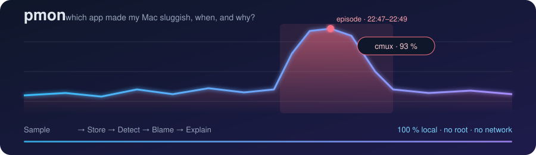
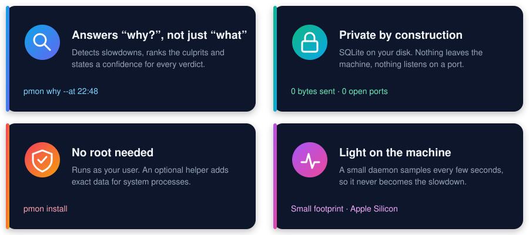

# pmon



A local macOS monitor that answers one question: **which application made my Mac sluggish, when, and why?**

A small background daemon samples the machine every few seconds, stores the results in a local SQLite database, detects slowdowns and works out which apps caused them. Nothing leaves the machine, nothing listens on a port, and no root access is needed.

```
$ pmon why --at 22:48
Fri 20 Nov 22:47:36–22:49:16 (1.7 min): CPU contention, peak 100 of 100.
Main cause: cmux — 93 % of it; used 93 % of a core itself and started short-lived processes that used the CPU (2370 seen in a scan).
Also: WindowServer — 2 % of it; used 15 % of a core (peak 26 %) (system-owned, coarser data).
Context: cmux was in focus; you were at the Mac; Low Power Mode was on.
```

## Why pmon



## How it works


Requirements: macOS 14 or later on Apple Silicon, and Swift 6 (Xcode 16 or the command-line tools) to build.

## Where to go next

| If you want to… | Read |
|---|---|
| Get it running | [Install, upgrade, uninstall](install.md) |
| Find out why the Mac was slow | [Everyday use](usage.md) |
| Understand the numbers and the word "confidence" | [Reading the output](READING-REPORTS.md) |
| Change what is collected | [Configuration](CONFIGURATION.md) |
| Get exact data for system processes | [The root helper](helper.md) |
| Know what is recorded and what it costs | [Privacy and cost](privacy.md) |
| See how it works inside | [Design](design.md) |
