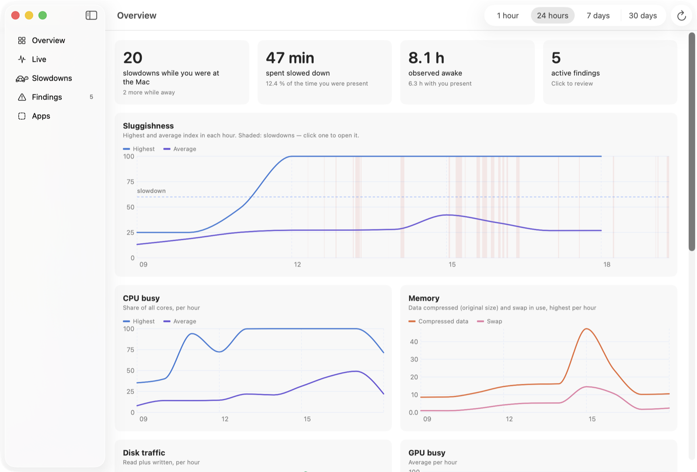

# Everyday use

| Question | Command |
|---|---|
| Is anything wrong right now? | `pmon status` |
| Why was it slow just now, or at 14:32? | `pmon why`, `pmon why --at 14:32` |
| What slowdowns were there this week? | `pmon episodes --since 7d` |
| Which apps cause the most trouble? | `pmon top --since 7d` |
| Is anything leaking, spinning or filling the disk? | `pmon findings` |
| What has one app been doing? | `pmon app Safari` |
| Give me the whole picture | `pmon report --since 7d --open` |
| Get the data into another tool | `pmon export episodes --format csv` |

`status`, `why`, `episodes`, `top` and `findings` accept `--json`.

By default, `episodes`, `top` and `report` leave out slowdowns that happened while nobody was at the Mac (screen locked, display off, or no input for two minutes). Add `--all` to include them.

How to read the output, and what "confidence" means: [Reading the output](READING-REPORTS.md). Every setting: [Configuration](CONFIGURATION.md).

## The dashboard

The menu-bar item (`pmon menu install`) opens one window with five tabs. Every menu entry opens the same window, on the matching tab:

| Tab | What it shows | Menu entry |
|---|---|---|
| Overview | Headline numbers and history for 1 hour to 30 days: sluggishness, CPU, memory, disk, GPU, the applications that caused slowdowns, background cost | Open dashboard… (⌘D) |
| Live | The last 5 to 60 minutes, sample by sample, refreshed every 5 seconds: the index and what drives it, CPU, memory, disk, network, and the applications busy right now | Live charts… (⌘L), or click the index line |
| Slowdowns | Every recorded slowdown; select one for the explanation, the minutes around it, who caused it and any captured evidence | Explain the latest slowdown… (⌘E), Slowdowns…, or click a "Last slowdown" line |
| Findings | Leaks, runaway processes, wakeup storms, heavy writers; select one for its evidence and the application's memory and CPU over that period | Findings… (⌘F) |
| Apps | Applications by CPU used; select one for its CPU, memory and disk over time, the slowdowns it took part in and its findings | Applications… |

Most things can be drilled into: click a shaded slowdown on a chart, an application in a ranking or table, or a finding in an application's page. Closing the window leaves the menu-bar item running.

`pmon-menu --dashboard live` opens the window at launch; the tab can also be `episode:<id>`, `finding:<id>` or `app:<name>`.
